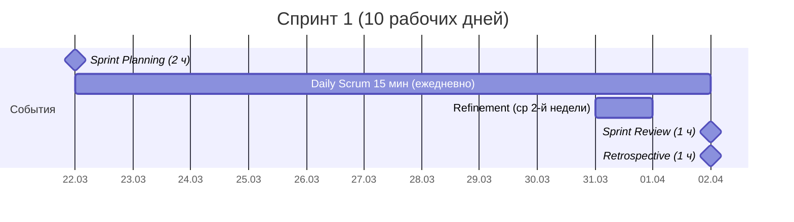

# Задача 7: Сервис аренды самокатов

**Студент:** Гордеенко А.В.

> Пик сезона через 6 недель, нужно ускорить поток. Спроектируйте Kanban с метриками lead time / cycle time (хотя бы оценочно на 6–8 карточках). Scrum: как вписать спринты в поток срочных багфиксов. XP: Continuous Integration, Small Releases, Pair Programming на критичных модулях.

Полное описание лабораторной — в ветке `main`, файл `tasks/lab-2.md`.

Состав решения: этот `README.md` (Scrum + XP), [`board.md`](board.md) (Kanban-доска, метрики), [`examples/`](examples/) (бэклог и ретро-чек-лист).

## Контекст

Продукт — мобильное приложение и бэкенд проката электросамокатов «СамоКат»: поиск самоката на карте, разблокировка по QR, поминутный тариф, оплата, история поездок. До пика сезона (1 мая) — **6 недель = 3 двухнедельных спринта**. Цель: к пику выдержать ×3 нагрузку и не терять поездки из-за багов.

Команда (7 человек):

| Роль | Кто | Что делает |
|------|-----|-----------|
| Product Owner | Марина | Владеет Product Backlog, расставляет приоритеты по «деньгам пика», принимает работу на Review |
| Scrum Master | Артём | Фасилитирует события, следит за WIP и за тем, чтобы срочные баги не рушили спринт |
| Developers | Илья (backend), Катя (backend, платежи), Денис (mobile), Оля (mobile) | Разрабатывают, делают ревью, дежурят по инцидентам |
| QA / DevOps | Сергей | Автотесты, пайплайн CI, мониторинг и откат релиза |

## 1. Scrum

### Артефакты

**Product Backlog** (фрагмент, порядок = приоритет; полный список в [`examples/product-backlog.md`](examples/product-backlog.md)):

| # | Item | Оценка (SP) | Ценность для пика |
|---|------|------------|-------------------|
| 1 | Расчёт тарифа «старт + минуты» с округлением | 5 | Прямая выручка |
| 2 | Push «заряд < 15 %» оператору | 5 | Меньше простоя парка |
| 3 | Блокировка самоката вне геозоны | 8 | Меньше потерь самокатов |
| 4 | Apple Pay / Google Pay | 8 | Конверсия оплаты |
| 5 | Экран «История поездок» | 3 | Снижение обращений в поддержку |
| 6 | Нагрузочное тестирование ×3 | 5 | Устойчивость в пик |

**Sprint Goal (спринт 1):** «Поездка считается и оплачивается корректно, а парк самокатов не теряется».

**Sprint Backlog спринта 1** (velocity команды ≈ 24 SP, берём 20 SP + резерв 4 SP на срочное):

| Item | SP | Исполнитель |
|------|----|-------------|
| Тариф «старт + минуты» | 5 | Катя + Илья |
| Push «заряд < 15 %» | 5 | Илья |
| Блокировка вне геозоны | 8 | Денис + Оля |
| Автотесты тарифа в CI | 2 | Сергей |
| **Резерв под срочные баги** | 4 | по ситуации |

**Increment** — версия, выложенная в продакшен (малыми релизами, см. XP) и удовлетворяющая Definition of Done: код прошёл ревью, CI зелёный, автотесты на изменённую логику, поездка проходит на стенде end-to-end, релиз-ноты написаны.

### События спринта (2 недели)

- **Sprint Planning** — PO предлагает цель, команда оценивает (Planning Poker) и берёт объём *по velocity минус резерв*.
- **Daily Scrum** — три вопроса + четвёртый: «есть ли срочное (Expedite) на доске и кто на нём?».
- **Review** — демо на тестовом самокате, обратная связь операторов парка.
- **Retrospective** — 1–2 улучшения процесса с владельцем и сроком.

### Как вписать спринты в поток срочных багфиксов

Проблема: в сезон баги прилетают непредсказуемо, а спринт нельзя менять «на ходу». Решение — гибрид Scrum + Kanban-дорожка Expedite:

1. **Резерв ёмкости 15–20 %** (4 из 24 SP) закладывается в Sprint Backlog заранее. Срочные баги тратят резерв, а не вытесняют цель спринта.
2. **Критерий «срочное»** (только так карточка попадает в Expedite): поездка не завершается или деньги списываются неверно; массовая недоступность (> 5 % самокатов); уязвимость. Всё остальное — в Product Backlog с приоритетом, решает PO.
3. **Лимит Expedite = 1.** Второй срочный баг — повод для разговора PO + SM: либо откладываем, либо убираем из спринта item того же размера (изменение Sprint Backlog согласует PO; Sprint Goal не меняется).
4. **Дежурный по инцидентам** меняется по кругу (ротация на спринт), чтобы остальные сохраняли фокус. Дежурный не берёт задач объёмом > 3 SP.
5. Каждый срочный баг после закрытия получает **пост-фикс**: регрессионный тест (иначе баг «вернётся») и запись в ретро.
6. Метрика здоровья: *доля ёмкости, ушедшая на Expedite*. > 25 % два спринта подряд — сигнал инвестировать в качество (технический спринт-цель).

Пример: в начале спринта 1 — баг «двойное списание при завершении поездки» (S-101). Дежурный Илья берёт карточку в Expedite, Катя в паре; исправление выкатывается за 1 день малым релизом; резерв уменьшился на 2 SP; Sprint Goal не пострадал.

## 2. Kanban

Доска, WIP-лимиты, правила перехода, срез состояния, метрики **lead time / cycle time на 8 карточках** и анализ узких мест — в [`board.md`](board.md).

Краткие выводы: средний lead time ≈ 6,7 дня, cycle time ≈ 4,6 дня, flow efficiency ≈ 68 %. Узкое место — колонка **Review / QA** (очередь ожидания) и внешняя зависимость по платёжному провайдеру (Blocked).

## 3. XP-практики

### 3.1 Continuous Integration

- **Как у нас:** каждый push в `main` и каждый Pull Request запускает пайплайн (линт → unit-тесты тарифа → интеграционные тесты API с тестовой БД → сборка Docker-образа). PR нельзя смержить с красным пайплайном. Мержим в `main` минимум раз в день.
- **Зачем:** тариф и геозоны — ядро денег; ошибка в расчёте «округление минут» ловится за ~4 минуты, а не после релиза.
- **Без практики:** ветки живут по неделе, интеграция в конце спринта = «merge hell» перед пиком, баги вроде двойного списания находит пользователь.

### 3.2 Small Releases

- **Как у нас:** выкладываем в продакшен *каждую законченную карточку* (feature flag включает функцию постепенно: 5 % → 25 % → 100 % парка). Релиз — один мерж, откат — выключение флага или `git revert` одного коммита (≤ 10 минут).
- **Зачем:** в сезон цена простоя высока; малый релиз — малый радиус поражения и быстрая обратная связь от реальных поездок.
- **Без практики:** «большой релиз раз в спринт» в пятницу вечером: 6 фич сразу, непонятно, что сломало поездки, откат тянет за собой всё остальное.

### 3.3 Pair Programming на критичных модулях

- **Как у нас:** модули «Тарификация/платежи» и «Блокировка/разблокировка самоката» разрабатываются **только в паре** (Катя + Илья; Денис + Оля), роли driver/navigator меняются каждые 30 минут. Дежурный по инциденту всегда работает в паре со вторым разработчиком.
- **Зачем:** двое видят граничные случаи («0 минут», «поездка через полночь», «потеря связи при завершении»); знания о платёжном модуле не принадлежат одному человеку (риск «автобуса»).
- **Без практики:** один человек, критичный код без второго взгляда; ошибка в формуле тарифа уходит в прод, а отпуск Кати парализует платежи в пик.
- **Баланс:** остальные задачи (тексты, простые экраны) — по одному, ревью через PR, чтобы не терять пропускную способность.

## Сводка: как это ускоряет поток к пику

| Приём | Что ускоряет | Метрика |
|-------|--------------|---------|
| WIP-лимиты + Expedite = 1 | Меньше незавершёнки и переключений | cycle time ↓ |
| CI + small releases | Быстрый путь «готово → в проде» | lead time ↓ |
| Парное программирование на критичном | Меньше возвратов из Review/QA | доля возвратов ↓ |
| Резерв 15–20 % | Срочное не ломает спринт | % выполнения Sprint Goal ↑ |
