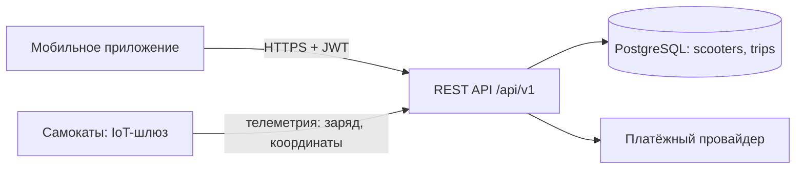
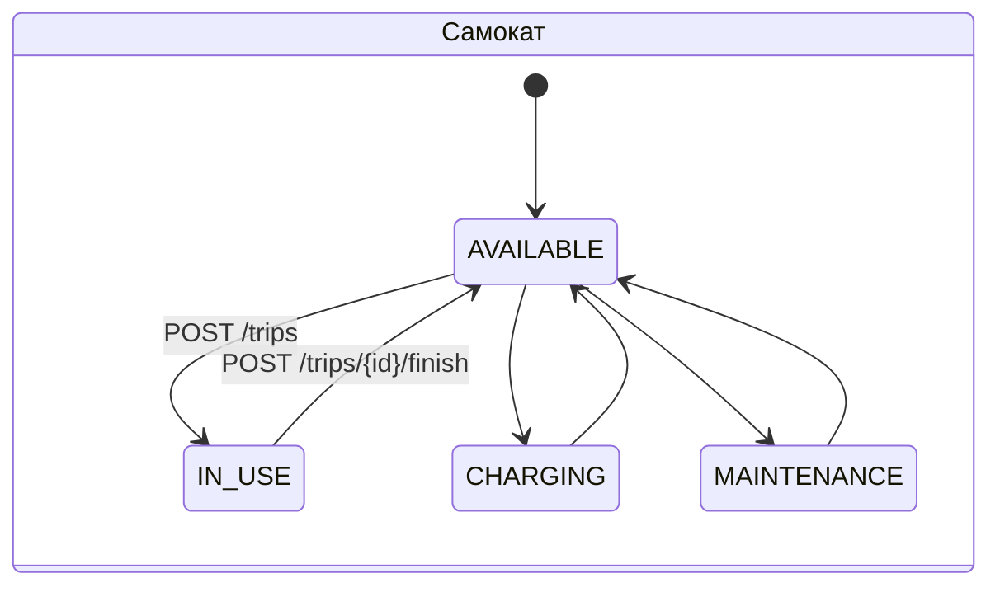

# Техническая документация «СамоКат API»

## Архитектура (кратко)



- **API** — единственная точка входа для мобильного приложения; контракт описан в [`openapi.yaml`](../openapi.yaml).
- **IoT-шлюз** присылает заряд и координаты самокатов; на основе этого API определяет статус и доступность.
- **Платёжный провайдер** вызывается при завершении поездки (списание стоимости).
- В учебной версии реализован только контракт: `openapi.yaml` + статичный Swagger UI (см. ниже).

## Структура репозитория

```
README.md               # постановка, навигация
openapi.yaml            # спецификация API (OpenAPI 3.0.3)
docs/user.md            # руководство пользователя
docs/tech.md            # этот документ
docs/swagger.html       # Swagger UI для просмотра спецификации
scripts/validate_openapi.py   # проверка структуры spec
```

## Сущности и статусы

### Самокат (`Scooter`)

| Статус | Значение | Переходы |
|--------|----------|----------|
| `AVAILABLE` | свободен, виден на карте | → `IN_USE` (старт поездки), → `CHARGING`, → `MAINTENANCE` |
| `IN_USE` | идёт поездка | → `AVAILABLE` (завершение поездки) |
| `CHARGING` | на зарядке, для аренды недоступен | → `AVAILABLE` (заряд ≥ 20 %) |
| `MAINTENANCE` | на обслуживании | → `AVAILABLE` (после ремонта) |

### Поездка (`Trip`)

| Статус | Значение | Переходы |
|--------|----------|----------|
| `ACTIVE` | поездка идёт | → `FINISHED`, → `CANCELED` |
| `FINISHED` | завершена, стоимость рассчитана | конечный |
| `CANCELED` | отменена (в течение 1 минуты без пробега) | конечный |



**Связь:** `POST /trips` одновременно переводит самокат `AVAILABLE → IN_USE` и создаёт поездку `ACTIVE`. `POST /trips/{id}/finish` переводит поездку `ACTIVE → FINISHED` и самокат `IN_USE → AVAILABLE`. Любое другое состояние даёт ответ **409 Conflict**.

## Расчёт стоимости

`cost = START_FEE + ceil(duration_seconds / 60) × PER_MINUTE`, где `START_FEE = 50 ₽`, `PER_MINUTE = 8 ₽`. Значение `durationMinutes` в ответе — уже округлённые вверх оплачиваемые минуты.

## Договорённости по API

| Тема | Правило |
|------|---------|
| Авторизация | заголовок `Authorization: Bearer <JWT>`; идентификатор пользователя берётся из токена |
| Формат | JSON, время — ISO 8601 UTC (`2027-04-10T08:15:00Z`) |
| Ошибки | тело `{ "code": "...", "message": "..." }`; коды: 401 — нет токена, 404 — объект не найден, 409 — конфликт состояния |
| Пагинация | `limit` (1–100, по умолчанию 20) и `offset`; ответ `{items, total}` |
| Версионирование | в пути: `/api/v1` |

## Конфигурация

| Переменная | Значение по умолчанию | Назначение |
|------------|-----------------------|-----------|
| `START_FEE` | `50` | плата за старт, ₽ |
| `PER_MINUTE` | `8` | цена минуты, ₽ |
| `MIN_BATTERY_PERCENT` | `20` | ниже этого заряда самокат не `AVAILABLE` |
| `DATABASE_URL` | — | строка подключения PostgreSQL |

## Как посмотреть и проверить спецификацию

```bash
pip install pyyaml openapi-spec-validator
python scripts/validate_openapi.py        # проверка структуры OpenAPI

python -m http.server 8080                # из корня репозитория
# открыть http://localhost:8080/docs/swagger.html
```

Другие способы: вставить `openapi.yaml` в <https://editor.swagger.io>.
