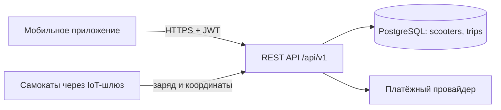
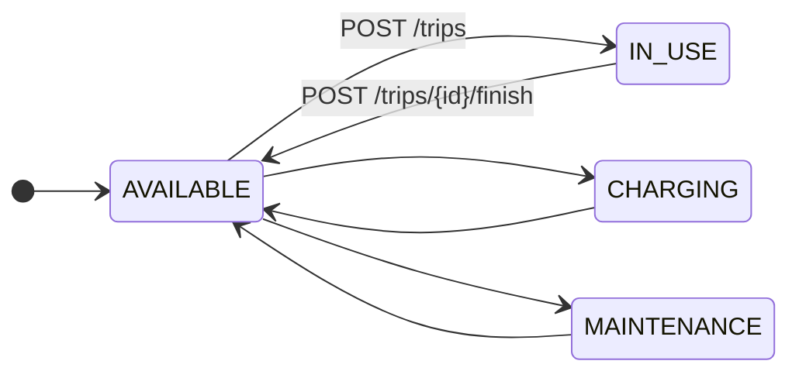

# Техническая документация "СамоКат API"

## Архитектура



- Приложение общается только с API. Все методы описаны в [`openapi.yaml`](../openapi.yaml).
- Самокаты через IoT-шлюз присылают заряд и координаты. По ним API понимает, можно ли сдавать самокат.
- Когда поездка завершается, API вызывает платёжного провайдера и списывает деньги.
- В этой учебной работе сделана только спецификация API и Swagger UI, самого сервера нет.

## Структура репозитория

- `README.md` - постановка и ссылки
- `openapi.yaml` - спецификация API (OpenAPI 3.0.3)
- `docs/user.md` - руководство пользователя
- `docs/tech.md` - этот файл
- `docs/swagger.html` - страница Swagger UI
- `scripts/validate_openapi.py` - проверка спецификации

## Статусы

### Самокат (Scooter)

| Статус | Что значит | Куда может перейти |
|--------|-----------|--------------------|
| `AVAILABLE` | свободен, виден на карте | `IN_USE` (начали поездку), `CHARGING`, `MAINTENANCE` |
| `IN_USE` | на нём сейчас едут | `AVAILABLE` (поездку завершили) |
| `CHARGING` | заряжается, брать нельзя | `AVAILABLE` (когда заряд от 20%) |
| `MAINTENANCE` | на ремонте | `AVAILABLE` (после ремонта) |

### Поездка (Trip)

| Статус | Что значит | Куда может перейти |
|--------|-----------|--------------------|
| `ACTIVE` | поездка идёт | `FINISHED`, `CANCELED` |
| `FINISHED` | завершена, цена посчитана | никуда |
| `CANCELED` | отменена в первую минуту без поездки | никуда |



Как статусы связаны между собой: `POST /trips` переводит самокат из `AVAILABLE` в `IN_USE` и создаёт поездку со статусом `ACTIVE`. `POST /trips/{id}/finish` переводит поездку в `FINISHED`, а самокат обратно в `AVAILABLE`. Если статус не подходит (самокат занят, поездка уже завершена), API отвечает 409.

## Как считается цена

```
cost = START_FEE + ceil(секунды / 60) * PER_MINUTE
```

По умолчанию `START_FEE = 50`, `PER_MINUTE = 8` (рубли). Минуты округляются вверх. В ответе API поле `durationMinutes` - это уже округлённые минуты, за которые платит пользователь.

## Правила API

- Авторизация: заголовок `Authorization: Bearer <JWT>`. Какой пользователь делает запрос, API берёт из токена.
- Всё в JSON. Время в формате ISO 8601 в UTC, например `2027-04-10T08:15:00Z`.
- Ошибки приходят в виде `{"code": "...", "message": "..."}`. 401 - нет токена, 404 - не найдено, 409 - неподходящий статус.
- История поездок постранично: параметры `limit` (от 1 до 100, по умолчанию 20) и `offset`, в ответе `items` и `total`.
- Версия API в пути: `/api/v1`.

## Настройки (переменные окружения)

| Переменная | По умолчанию | Для чего |
|------------|--------------|---------|
| `START_FEE` | 50 | цена старта, руб. |
| `PER_MINUTE` | 8 | цена минуты, руб. |
| `MIN_BATTERY_PERCENT` | 20 | если заряд ниже, самокат не показывается как свободный |
| `DATABASE_URL` | нет | подключение к PostgreSQL |

## Как посмотреть спецификацию

```bash
pip install pyyaml openapi-spec-validator
python scripts/validate_openapi.py

python -m http.server 8080
# открыть http://localhost:8080/docs/swagger.html
```

Или вставить `openapi.yaml` на https://editor.swagger.io.
